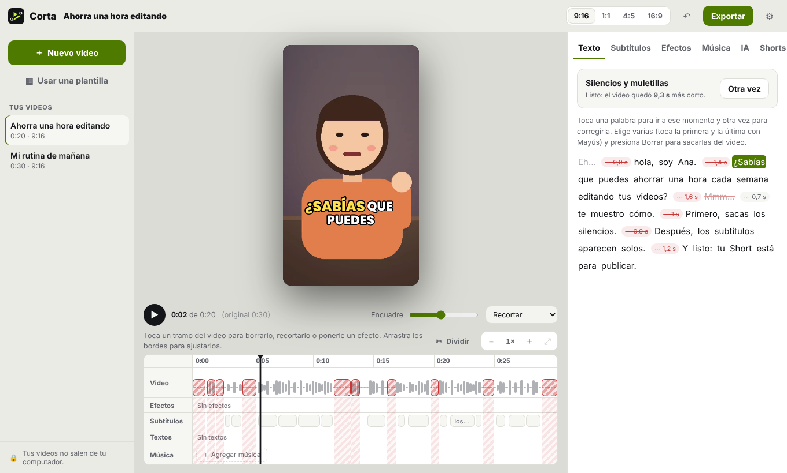
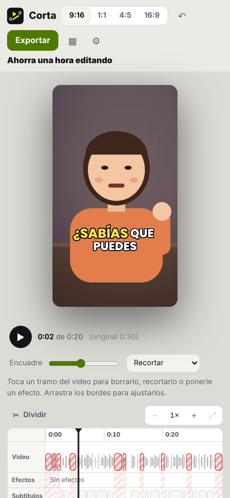
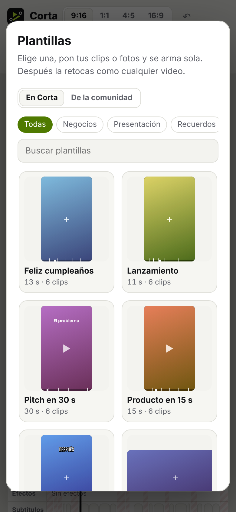

<p align="center"></p>

<h1 align="center">Corta</h1>

<p align="center"><b>El editor gratis y de código abierto para Shorts, Reels y TikTok.</b><br>
Editas el texto y se edita el video. Subtítulos animados, sin silencios ni muletillas, y tu propia IA hace el trabajo pesado.<br>
Todo en tu computador: tus videos no se suben a ningún lado. Sin marca de agua.</p>

<p align="center"><a href="https://corta-app.github.io/corta/"><b>Página</b></a> ·
<a href="https://corta-app.github.io/corta/demo/"><b>Pruébala en el navegador</b></a> ·
<a href="#instalar">Instalar</a> ·
<a href="https://github.com/corta-app/corta/discussions">Comunidad</a> ·
<a href="#como-aportar">Cómo aportar</a> ·
<a href="#english">English</a></p>

<p align="center"><picture><source srcset="docs/img/editor.png" media="(prefers-color-scheme: dark)"></picture></p>
<p align="center">
<picture><source srcset="docs/img/app-celular-oscuro.png" media="(prefers-color-scheme: dark)"></picture>
<picture><source srcset="docs/img/app-plantillas-oscuro.png" media="(prefers-color-scheme: dark)"></picture>
</p>
<p align="center"><sub>Video de mentira: Ana es dibujada y su voz es sintética.</sub></p>

---

## Qué hace
- **Edita por texto.** Corta transcribe tu video en tu computador, palabra por palabra. Borras una frase y se borra del video.
- **Saca silencios y muletillas** de una vez («eh», «mmm», pausas largas). Lo puedes deshacer cuando quieras.
- **Subtítulos animados** al estilo de los Shorts, en cualquier idioma. Los estilos son archivos simples que cualquiera puede crear.
- **Corrige cualquier palabra** tocándola, en el texto o sobre el video, sin perder los tiempos. Si el nombre de tu marca salió mal,
  lo cambias en todo el video de una vez y Corta lo recuerda para tus próximos videos.
- **Vertical primero:** 9:16, 1:1, 4:5 o 16:9, con encuadre ajustable o fondo borroso para videos horizontales.
- **Dile a tu IA lo que quieres:** «pon zoom cuando digo el precio», «saca la parte donde me equivoco», «pon un título al inicio».
  Si no te gusta, **«Quitar»** deshace justo ese cambio de la IA, aunque hayas seguido editando.
- **Shorts desde un video largo:** tu IA elige los mejores momentos de una clase, un podcast o un live, y cada uno queda como un video nuevo.
- **Velocidad y cámara lenta:** toca un tramo y elige 0,25× a 3× (o un valor exacto). Subtítulos, textos y efectos siguen
  sincronizados; la voz mantiene su tono (bajo 0,5× se silencia sola, y tú decides) y la música no se acelera. Una **rampa** pasa
  suave de 1× a cámara lenta y vuelve, justo en el momento clave, y **Suavizar** evita que la cámara lenta salte. También se lo
  puedes pedir a tu IA: «pon en cámara lenta cuando digo…».
- **Cortes, efectos y filtros:** divide en el cabezal, borra o recorta un tramo, y ponle a todo el video o a un momento un filtro
  (blanco y negro, cálido, vintage…), un zoom o una transición en cada corte: interferencia, destello, franjas, rebote, barrido o
  zoom de paso, con la misma imagen en la vista previa y al exportar. Los efectos son archivos simples: la comunidad crea más en el
  [catálogo](https://github.com/corta-app/corta-catalogo) y los descargas gratis desde la app, ordenados por categoría.
- **Plantillas:** elige una (presentación de producto, pitch en 30 s, antes y después, recuerdos del mes, receta rápida…), pon tus
  clips o fotos y se arma sola, con sus cortes, transiciones, efectos y textos. Después la retocas como cualquier video. La comunidad
  aporta más en el [catálogo](https://github.com/corta-app/corta-catalogo#plantillas), por categorías y gratis.
- **Música de fondo que baja sola cuando hablas**, y una **línea de tiempo con pistas** (video, subtítulos, textos y música) donde
  arrastras los bordes con el mouse, el dedo o el teclado.

<a id="instalar"></a>
## Instalar

| | Cómo | Estado |
|---|---|---|
| 🌐 **Navegador** | [Vista previa con un video de mentira](https://corta-app.github.io/corta/demo/): nada que instalar. | Para mirar cómo funciona |
| 🍎 **Mac** | [Desde el código](#instalar-en-mac) con `bash build.sh` (Apple Silicon, macOS 15). Trae todo adentro. | Funciona; aún sin versión publicada ni firma de Apple |
| 🪟 🐧 **Windows y Linux** | La misma interfaz, en una app de escritorio. | En camino |

La IA es opcional y es la tuya, con tu cuenta: Claude Code, Codex (ChatGPT) o Gemini CLI
([cómo instalarla](https://corta-app.github.io/corta/ia.html)). Sin IA igual editas por texto, limpias silencios, pones subtítulos,
efectos y plantillas. En GitHub, **Watch → Custom → Releases** te avisa cuando salga la primera versión para descargar.

## Tus videos son tuyos
- Transcripción (whisper.cpp) y exportación (ffmpeg) en tu computador. **No hay servidores de Corta**, ni cuentas, ni telemetría.
- La IA es **la tuya** (Claude Code, Codex o Gemini), con tu cuenta, y solo ve el texto con sus tiempos. Nunca el video ni el audio.
- El video original nunca se modifica: los cambios viven en un `proyecto.json` abierto, con historial para deshacer.
- Sin marca de agua, sin límite de resolución ni de duración.

<a id="como-aportar"></a>
## Cómo aportar
Corta es gratis y abierta, y la hacemos entre todos. Casi nada exige programar:
- 💬 **Crea un estilo de subtítulos, un efecto o una plantilla:** son archivos JSON cortos ([estilos](estilos/README.md),
  [efectos](efectos/README.md), [plantillas](plantillas/README.md)) y se comparten en el
  [catálogo de la comunidad](https://github.com/corta-app/corta-catalogo), desde donde cualquiera los descarga gratis en la app.
  Una plantilla la puedes proponer con palabras, sin escribir el JSON.
- 🎬 **Pruébala con tus videos:** los issues con la etiqueta [`probar`](https://github.com/corta-app/corta/labels/probar).
- 🗣️ **Conversa** en [Discussions](https://github.com/corta-app/corta/discussions): dudas, ideas o lo que publicaste.
- 🛠️ **Programa, con o sin IA:** [`AGENTS.md`](AGENTS.md) es la guía para personas y para cualquier IA de programación. Empieza
  por [CONTRIBUTING.md](CONTRIBUTING.md).

Al participar aceptas el [código de conducta](CODE_OF_CONDUCT.md). ¿Una falla de seguridad? Avísanos en privado: [SECURITY.md](SECURITY.md).

## Estado
Versión 0.1, recién nacida. Ya funcionan el motor (cortes, silencios, subtítulos, zooms, textos, encuadre, exportación vertical,
edición con IA y Shorts), la interfaz y la **app para Mac** (Apple Silicon, macOS 15 o más nuevo). Windows y Linux vienen en camino.
Puedes [probar la interfaz con un video de mentira](https://corta-app.github.io/corta/demo/).

## Instalar en Mac
Corta para Mac trae todo adentro: no necesitas instalar Python, ffmpeg ni whisper. Mientras no haya una versión publicada, se arma
desde el código en tu Mac (necesitas las herramientas de línea de comandos de Xcode: `xcode-select --install`):
```bash
git clone https://github.com/corta-app/corta ~/Developer/corta   # no en ~/corta: macOS no distingue ~/corta de ~/Corta (tus videos)
cd ~/Developer/corta && bash build.sh                            # queda en ~/Applications/Corta.app
```
La primera vez elige tu idioma, tu IA y descarga el transcriptor (se verifica su huella). Tus videos y proyectos quedan en `~/Corta`;
actualizar nunca los toca. Corta revisa sola si hay una versión nueva (en una instalación desde el código, con `git pull`).
Dentro de la app van [ffmpeg](https://ffmpeg.org) (GPL, como programa aparte), [whisper.cpp](https://github.com/ggml-org/whisper.cpp)
(MIT) y Python portátil, todos descargados con su huella SHA-256 fija (`herramientas/empaquetar.sh`).

## Cómo funciona
```
tu video ──► whisper (en tu computador) ──► palabras con tiempos ──► editas el texto / limpias / le pides a tu IA
                                                                         │
                                         proyecto.json (cortes, subtítulos, zooms, textos) ◄─┘
                                                                         │
                                               ffmpeg ──► exportado-9x16.mp4 (con subtítulos)
```

## Formato del proyecto
Cada video vive en `~/Corta/<fecha> <nombre>/`: `original.<ext>` (tu video tal cual), `proyecto.json`, `historial/` (para deshacer),
`musica/` (una copia de la música que elegiste) y lo que exportas. Un video hecho con una plantilla tiene `clips/` (copias de tus
clips y fotos) y `plantilla-N.mp4` (los clips ya armados) en vez de `original.<ext>`. `proyecto.json` es abierto: puedes armar tus propios scripts encima (ver [`ejemplos/`](ejemplos/)).

| Campo | Qué guarda |
|---|---|
| `fuente` | `{archivo, duracion, ancho, alto}` del video original. |
| `lienzo`, `relleno`, `encuadre` | Formato (`9:16`, `1:1`, `4:5`, `16:9`), `recorte` o `desenfoque`, y qué parte del video se ve (`x`, `y` de 0 a 1). |
| `palabras` | `[{t, i, f, linea?}]`: cada palabra con su inicio y fin en segundos del original. `linea` (opcional) es lo que decidiste a mano: `"fin"` corta la frase del subtítulo después de esa palabra y `"sigue"` la une con la siguiente. |
| `cortes` | `[{i, f, motivo}]`: lo que no va. `motivo`: `silencio`, `muletilla`, `manual`, `ia` o `fuera` (fuera de un Short). |
| `subtitulos` | `{activos, estilo, palabras_por_linea, posicion}` |
| `zooms`, `textos` | `[{i, f, escala}]` y `[{i, f, texto, y}]` |
| `efectos` | (opcional) `[{efecto, pasos, i?, f?, origen?}]`: los efectos aplicados, con sus pasos copiados (formato en [`efectos/README.md`](efectos/README.md)). Sin `i`/`f`, a todo el video. |
| `velocidades` | (opcional) `[{i, f, v, rampa?, audio?, suavizar?, origen?}]`: la velocidad de un tramo del original, sin traslaparse. `v` de 0,25 a 3 (menos de 1 es cámara lenta). `rampa: true` pasa suave de 1× a `v` (hasta 0,75) y vuelve: sube en el primer 30 % del tramo y baja en el último 30 % (al menos 0,5 s). `audio`: `"tono"` (la voz más lenta o rápida con su tono, `atempo`) o `"silencio"`; sin decirlo, bajo 0,5× (y en una rampa así) se silencia. `suavizar` (solo en cámara lenta): `"mezcla"` (funde cuadros, casi gratis) o `"movimiento"` (inventa los cuadros que faltan; exportar tarda mucho más). Todo lo demás (palabras, textos, efectos) sigue en segundos del original: al exportar, cada momento cae donde le toca. |
| `divisiones` | (opcional) `[segundos]`: dónde dividiste el video en la línea de tiempo (para elegir tramos). Al exportar no cortan nada: una transición del tramo pestañea ahí, como en un corte. |
| `plantilla` | (opcional, solo en un video hecho con una plantilla) `{id, huecos: [{archivo, tipo, desde, dur, duracion}]}`: qué clip o foto (una copia en `clips/`) va en cada hueco, desde qué segundo y cuánto dura el hueco. Lo cambia solo la app (pestaña Clips), que vuelve a armar el video (`fuente`). |
| `cambios_ia` | (opcional) Lo que hizo tu IA, para quitar justo ese cambio aunque hayas seguido editando: `[{id, estado: "aplicado" \| "quitado", pedido, resumen, fecha, agregados: {zooms, textos, cortes, efectos, velocidades}, ajustes?: [{campo, antes, despues}], restaurados?: {antes, despues}, palabras?: [{antes, despues}], conservados?}]` (los últimos 20). Lo que agregó la IA lleva `"origen": "<id>"`. |
| `musica` | `null` o `{archivo, volumen}`: `archivo` relativo a la carpeta del proyecto (la app copia la canción a `musica/`) o una ruta absoluta; `volumen` de 0 a 1. La música baja sola cuando hablas. |

Todos los tiempos están en segundos **del video original**: los cortes dicen qué se saca y lo demás se conserva. Un tramo a 0,5×
dura el doble en el video exportado; un programa que lea el formato puede pasar al tiempo exportado con `proyecto.a_salida`.

### Vocabulario
`~/Corta/vocabulario.json` guarda las palabras que corregiste y pediste recordar:
```json
{"formato": 1, "reemplazos": [{"de": "calumi", "a": "Kalumi"}], "palabras": ["Kalumi"]}
```
Al transcribir un video nuevo, cada reemplazo se aplica por palabra completa (sin mirar tildes ni mayúsculas; `de` puede tener varias
palabras, como «ca lumi») y las palabras propias se le pasan al transcriptor como vocabulario, para que reconozca mejor nombres y
marcas. Lo ves y lo borras en Ajustes → Vocabulario.

### Efectos
Los efectos son JSON de solo datos (formato en [`efectos/README.md`](efectos/README.md)). Vienen algunos incluidos (`efectos/`) y los
que descargas del [catálogo de la comunidad](https://github.com/corta-app/corta-catalogo) quedan en `~/Corta/.corta/efectos/`. La
app solo descarga desde `raw.githubusercontent.com/corta-app/corta-catalogo`, compara la huella SHA-256 del índice y valida cada
efecto con el mismo formato que el catálogo antes de guardarlo.

### Plantillas
Las plantillas son JSON de solo datos (formato en [`plantillas/README.md`](plantillas/README.md)): huecos con su duración, efectos y
transiciones por nombre, textos, la velocidad de cada hueco (cámara lenta, rápida o una rampa) y el ritmo de la música para el que se pensaron (nunca un archivo de audio). Vienen 12 incluidas
(`plantillas/`) y las que descargas del [catálogo](https://github.com/corta-app/corta-catalogo#plantillas) quedan en
`~/Corta/.corta/plantillas/`, con la misma descarga verificada que los efectos. Si una plantilla usa un efecto del catálogo que no
tienes, Corta te ofrece descargarlo.

## Desarrollo
Necesitas Python 3 (solo biblioteca estándar), ffmpeg y, para transcribir, whisper.cpp (`whisper-cli`). La app de Mac está en
`app/` (Swift Package Manager, sin proyecto de Xcode): `bash build.sh` la arma e instala.
```bash
cd ui && python3 -m http.server 8765         # interfaz con el video de mentira: http://localhost:8765 (?idioma=en, ?bienvenida, ?vacio)
python3 bin/importar.py mi-video.mp4 /tmp/r.json   # crea el proyecto en ~/Corta
python3 bin/limpiar.py "<carpeta>" 0.5 1 /tmp/r.json
python3 bin/render.py "<carpeta>" /tmp/r.json      # exporta
bash pruebas/correr.sh                       # todas las pruebas
```
Lee [`AGENTS.md`](AGENTS.md) antes de cambiar algo: sirve igual para personas y para tu IA.

## Licencia
[AGPL-3.0](LICENSE). Puedes usar, estudiar, cambiar y compartir Corta. Si la ofreces como servicio o la distribuyes modificada,
tienes que publicar tu código con la misma licencia. Las tipografías de `ui/fuentes/` usan la [SIL Open Font License](ui/fuentes/OFL.txt).

---

## English
**Corta** ("cut") is a free, open-source editor for Shorts, Reels and TikTok. It transcribes your video on your computer, so you edit
the video by editing its text; it removes silences and filler words in one click, adds animated captions in any language, reframes
landscape footage to vertical, and lets your own AI (Claude Code, Codex or Gemini, with your account) apply edits from plain requests
or pick the best moments of a long video as new Shorts. Add background music that ducks itself under your voice and fine-tune cuts,
zooms and text on a multi-track timeline. Videos never leave your computer, there's no watermark, and the project is a
plain open JSON file. Caption styles are data-only files anyone can create. Fix any caption word in place (Corta remembers your
brand names for future videos), split and trim segments, and add filters, zooms and transitions (glitch, flash, split, bounce,
swipe, zoom through) to the whole video or one moment. Change the speed of any segment (0.25× to 3×, or a smooth slow-motion
ramp right at the key moment) with captions and text kept in sync, the voice keeping its pitch and the music untouched; the community shares more effects in the
[catalog](https://github.com/corta-app/corta-catalogo), downloadable for free from the app.
**Templates:** pick one (product showcase, 30-second pitch, before and after, month in memories, quick recipe…), add your clips or
photos and it builds itself with its cuts, transitions, effects and texts; then edit it like any other video. Templates are data-only
JSON too, and the community shares more by category in the catalog.
Spanish-first, English included. Licensed under AGPL-3.0.

**Mac app** (Apple Silicon, macOS 15+): everything is bundled (Python, ffmpeg, whisper.cpp, all pinned by SHA-256). Until a release is
published, build it from source: `git clone https://github.com/corta-app/corta ~/Developer/corta && cd ~/Developer/corta && bash build.sh`
(installs to `~/Applications/Corta.app`; your videos live in `~/Corta`). Windows and Linux are on the way.

**Try it** in your browser with a made-up video: [live preview](https://corta-app.github.io/corta/demo/?idioma=en). If you don't
like an AI edit, **Remove** undoes just that change, even after you kept editing. Caption styles, effects and templates are welcome
in the [community catalog](https://github.com/corta-app/corta-catalogo); questions and ideas in
[Discussions](https://github.com/corta-app/corta/discussions), in English or Spanish. See [CONTRIBUTING.md](CONTRIBUTING.md).
